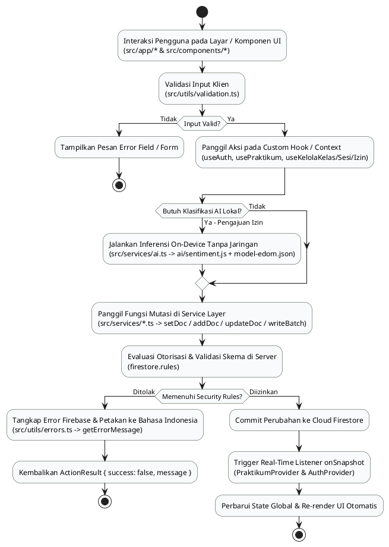
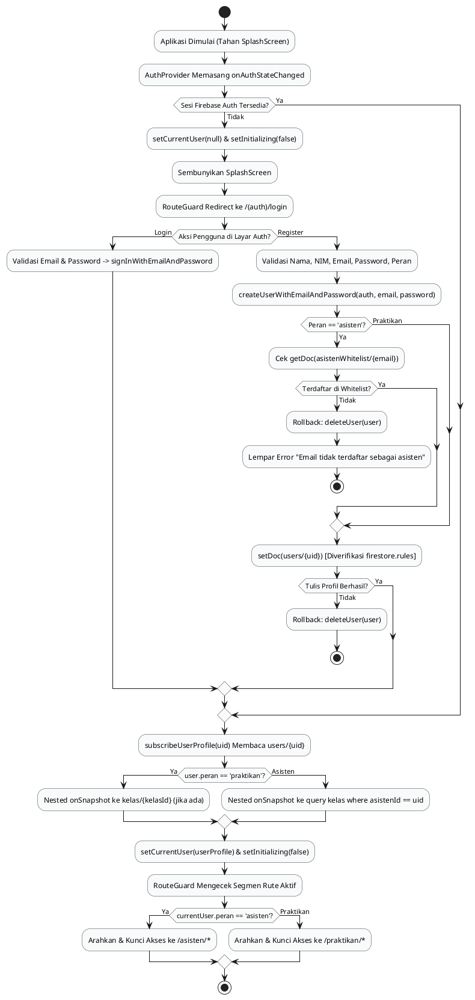
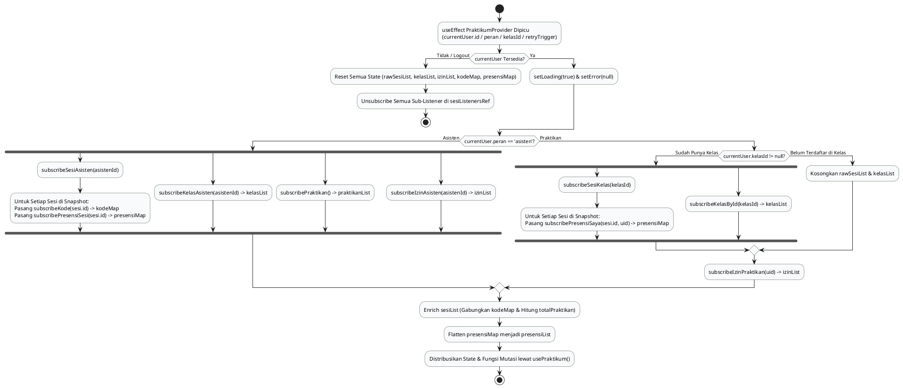
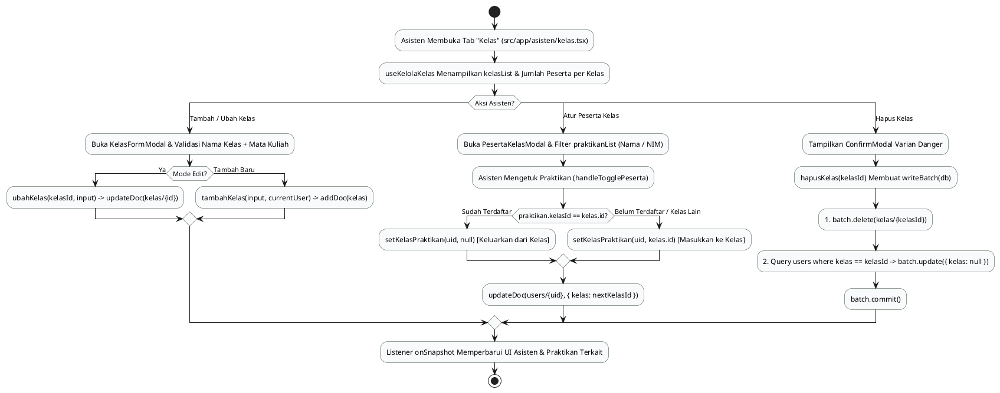
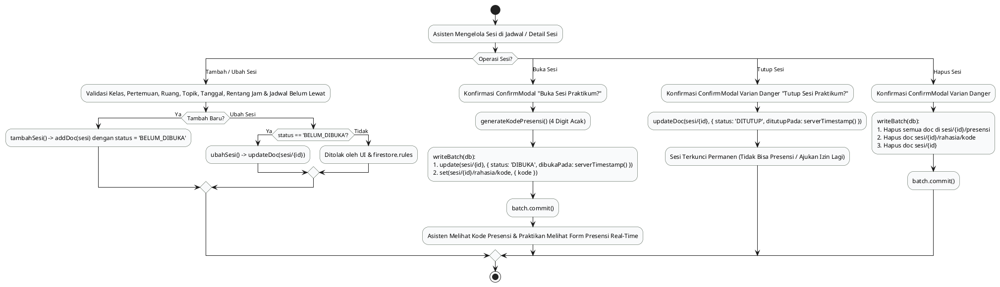
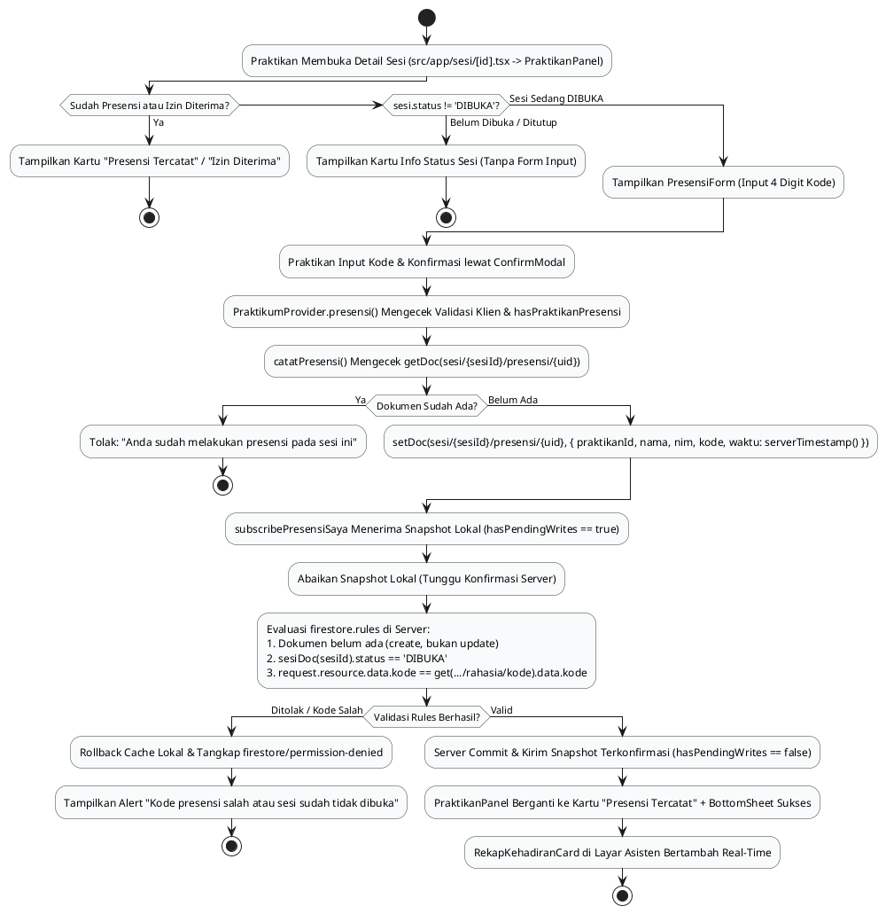
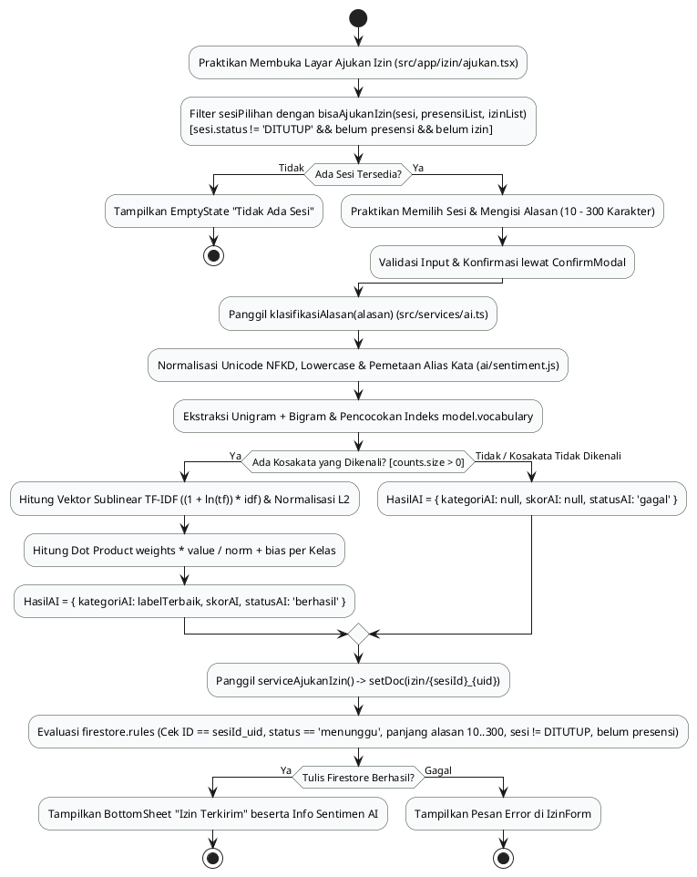
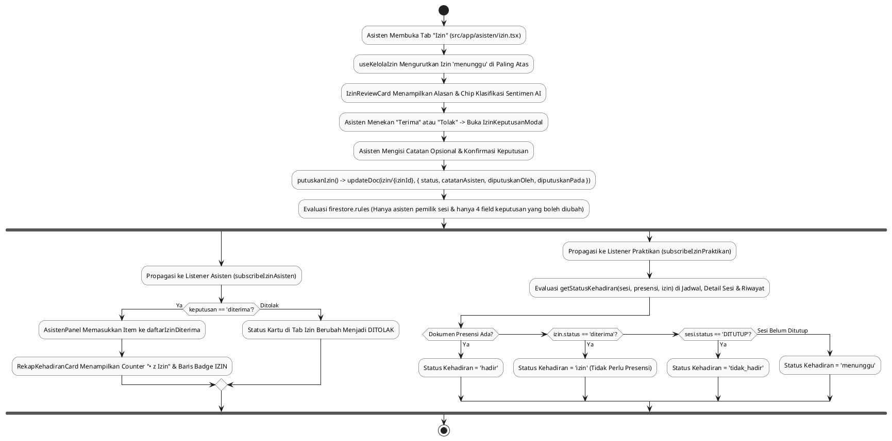

# Arsitektur Fungsional & Alur Proses — Manajemen Praktikum

Dokumentasi teknis ini membedah arsitektur fungsional proyek **Manajemen Praktikum** (React Native + Expo SDK 58 + Expo Router + React Native Firebase Auth/Firestore + On-Device AI Sentiment Classifier) dari ujung ke ujung (*end-to-end*), dilengkapi diagram alir proses PlantUML dan potongan kode inti (*core snippets*) pada setiap lapisan.

## Daftar Isi

- [Daftar Isi](#daftar-isi)
- [1. Arsitektur Lapisan & Skema Data Firestore](#1-arsitektur-lapisan--skema-data-firestore)
  - [1.1 Pemisahan Lapisan Aplikasi](#11-pemisahan-lapisan-aplikasi)
  - [1.2 Skema Koleksi Cloud Firestore](#12-skema-koleksi-cloud-firestore)
  - [1.3 Diagram Alir Arsitektur & Aliran Data](#13-diagram-alir-arsitektur--aliran-data)
  - [1.4 Snippet Inti Fondasi & Provider](#14-snippet-inti-fondasi--provider)
- [2. Alur Bootstrap, Autentikasi & Route Guard](#2-alur-bootstrap-autentikasi--route-guard)
  - [2.1 Mekanisme Login, Registrasi Whitelist & Route Guard](#21-mekanisme-login-registrasi-whitelist--route-guard)
  - [2.2 Diagram Alir Autentikasi & Proteksi Navigasi](#22-diagram-alir-autentikasi--proteksi-navigasi)
  - [2.3 Snippet Inti Autentikasi & Route Guard](#23-snippet-inti-autentikasi--route-guard)
- [3. Alur Orkestrasi Real-Time Listener (PraktikumProvider)](#3-alur-orkestrasi-real-time-listener-praktikumprovider)
  - [3.1 Langganan onSnapshot Berbasis Peran & Sub-Listener Sesi](#31-langganan-onsnapshot-berbasis-peran--sub-listener-sesi)
  - [3.2 Diagram Alir Orkestrasi Real-Time Listener](#32-diagram-alir-orkestrasi-real-time-listener)
  - [3.3 Snippet Inti Sub-Listener & Enrichment State](#33-snippet-inti-sub-listener--enrichment-state)
- [4. Alur Kelola Kelas & Penugasan Peserta (Asisten)](#4-alur-kelola-kelas--penugasan-peserta-asisten)
  - [4.1 Mekanisme CRUD Kelas, Toggle Peserta & Batch Delete](#41-mekanisme-crud-kelas-toggle-peserta--batch-delete)
  - [4.2 Diagram Alir Kelola Kelas & Peserta](#42-diagram-alir-kelola-kelas--peserta)
  - [4.3 Snippet Inti Batch Delete Kelas & Toggle Peserta](#43-snippet-inti-batch-delete-kelas--toggle-peserta)
- [5. Alur Kelola Jadwal/Sesi & Siklus Hidup Sesi](#5-alur-kelola-jadwalsesi--siklus-hidup-sesi)
  - [5.1 CRUD Sesi, Subkoleksi Rahasia Kode & Transisi Status](#51-crud-sesi-subkoleksi-rahasia-kode--transisi-status)
  - [5.2 Diagram Alir CRUD & Siklus Hidup Sesi](#52-diagram-alir-crud--siklus-hidup-sesi)
  - [5.3 Snippet Inti Pembukaan Sesi & Proteksi Kode Rahasia](#53-snippet-inti-pembukaan-sesi--proteksi-kode-rahasia)
- [6. Alur Presensi Praktikan & Anti-Presensi Ganda Berlapis](#6-alur-presensi-praktikan--anti-presensi-ganda-berlapis)
  - [6.1 Verifikasi 3 Lapis & Filter Pending Writes](#61-verifikasi-3-lapis--filter-pending-writes)
  - [6.2 Diagram Alir Presensi & Verifikasi Kode](#62-diagram-alir-presensi--verifikasi-kode)
  - [6.3 Snippet Inti Pencatatan Presensi & Security Rules](#63-snippet-inti-pencatatan-presensi--security-rules)
- [7. Alur Pengajuan Izin & Klasifikasi Sentimen AI On-Device](#7-alur-pengajuan-izin--klasifikasi-sentimen-ai-on-device)
  - [7.1 Pipeline Inferensi TF-IDF Lokal & Penyimpanan Izin](#71-pipeline-inferensi-tf-idf-lokal--penyimpanan-izin)
  - [7.2 Diagram Alir Pengajuan Izin & Inferensi AI](#72-diagram-alir-pengajuan-izin--inferensi-ai)
  - [7.3 Snippet Inti Inferensi AI & Penyimpanan Izin](#73-snippet-inti-inferensi-ai--penyimpanan-izin)
- [8. Alur Verifikasi Izin Asisten & Agregasi Kehadiran](#8-alur-verifikasi-izin-asisten--agregasi-kehadiran)
  - [8.1 Keputusan Izin & Penentuan Prioritas Status Kehadiran](#81-keputusan-izin--penentuan-prioritas-status-kehadiran)
  - [8.2 Diagram Alir Verifikasi Izin & Agregasi Rekap/Riwayat](#82-diagram-alir-verifikasi-izin--agregasi-rekapriwayat)
  - [8.3 Snippet Inti Keputusan Izin & Resolusi Status Kehadiran](#83-snippet-inti-keputusan-izin--resolusi-status-kehadiran)

---

## 1. Arsitektur Lapisan & Skema Data Firestore

### 1.1 Pemisahan Lapisan Aplikasi

Proyek menerapkan prinsip *Separation of Concerns* (SoC) dalam 4 lapisan utama sehingga komponen UI tidak pernah memanggil Firebase SDK atau model AI secara langsung:

| Lapisan | Direktori / File | Tanggung Jawab Utama |
|---|---|---|
| **1. Presentation & Routing** | `src/app/`, `src/components/` | Navigasi berbasis file (Expo Router), proteksi rute (`RouteGuard`), tampilan layar per peran (`asisten/`, `praktikan/`, `(auth)/`, `sesi/[id]`, `izin/ajukan`), modal, dan form input. |
| **2. State & Orchestration** | `src/context/`, `src/hooks/` | `AuthProvider` (status login & profil aktif), `PraktikumProvider` (langganan `onSnapshot` per peran & mutasi berpola `ActionResult<T>`), serta custom hooks CRUD (`useKelolaKelas`, `useKelolaSesi`, `useKelolaIzin`). |
| **3. Service & Domain Utils** | `src/services/`, `src/utils/`, `src/types.ts` | Abstraksi operasi Firestore (`auth.ts`, `users.ts`, `kelas.ts`, `sesi.ts`, `presensi.ts`, `izin.ts`), pembungkus AI (`ai.ts`), validasi input (`validation.ts`), pemetaan error (`errors.ts`), dan logika status kehadiran (`kehadiran.ts`). |
| **4. Data, Security & Local AI** | `src/lib/firebase.ts`, `firestore.rules`, `ai/` | Inisialisasi instance modular `@react-native-firebase`, otorisasi server di Cloud Firestore Rules, serta mesin inferensi sentimen JavaScript murni (`ai/sentiment.js` + `ai/model-edom.json`). |

### 1.2 Skema Koleksi Cloud Firestore

| Path Koleksi / Subkoleksi | Kunci Dokumen | Field Utama & Fungsi Arsitektural |
|---|---|---|
| `users/{uid}` | `uid` Firebase Auth | `nama`, `nim`, `email`, `peran` (`asisten` \| `praktikan`), `kelas` (`kelasId` atau `null`), `dibuatPada`. |
| `asistenWhitelist/{email}` | Email lowercase | Dokumen penanda email yang diizinkan mendaftar sebagai `asisten`. Hanya memperbolehkan `get` untuk pemilik email. |
| `kelas/{kelasId}` | Auto-ID | `nama`, `mataKuliah`, `asistenId`, `asistenNama`, `dibuatPada`. Peserta ditautkan melalui field `users/{uid}.kelas`. |
| `sesi/{sesiId}` | Auto-ID | `mataKuliah`, `pertemuan`, `topik`, `kelasId`, `kelas`, `tanggal`, `jamMulai`, `jamSelesai`, `ruang`, `catatan`, `asistenId`, `asistenNama`, `status` (`BELUM_DIBUKA` \| `DIBUKA` \| `DITUTUP`), `dibukaPada`, `ditutupPada`. |
| `sesi/{sesiId}/rahasia/kode` | Literal `'kode'` | `kode` (4 digit). Hanya dapat dibaca/ditulis oleh asisten pemilik sesi; dipakai oleh `firestore.rules` untuk memverifikasi presensi praktikan di sisi server. |
| `sesi/{sesiId}/presensi/{uid}` | `uid` Praktikan | `praktikanId`, `praktikanNama`, `praktikanNim`, `kode`, `waktu` (`serverTimestamp()`). Kunci `= uid` dengan `allow update: if false` menjamin anti-presensi ganda. |
| `izin/{sesiId}_{uid}` | `{sesiId}_{uid}` | `sesiId`, `praktikanId`, `praktikanNama`, `praktikanNim`, `asistenId`, `sesiLabel`, `alasan`, `kategoriAI`, `skorAI`, `statusAI`, `status` (`menunggu` \| `diterima` \| `ditolak`), `catatanAsisten`, `diajukanPada`, `diputuskanOleh`, `diputuskanPada`. |

### 1.3 Diagram Alir Arsitektur & Aliran Data



### 1.4 Snippet Inti Fondasi & Provider

**Inisialisasi Modular Firebase (`src/lib/firebase.ts` baris 6–10):**
```ts
import { getAuth } from '@react-native-firebase/auth';
import { getFirestore } from '@react-native-firebase/firestore';

export const auth = getAuth();
export const db = getFirestore();
```

**Hierarki Root Provider & Route Guard (`src/app/_layout.tsx` baris 62–97):**
```tsx
  return (
    <PraktikumProvider>
      <StatusBar style="dark" />
      <OfflineBanner />
      <RouteGuard>
        <Stack screenOptions={{ headerStyle: { backgroundColor: '#ffffff' } }}>
          <Stack.Screen name="index" options={{ headerShown: false }} />
          <Stack.Screen name="(auth)" options={{ headerShown: false }} />
          <Stack.Screen name="asisten" options={{ headerShown: false }} />
          <Stack.Screen name="praktikan" options={{ headerShown: false }} />
          <Stack.Screen name="sesi/[id]" options={{ title: 'Detail Sesi' }} />
        </Stack>
      </RouteGuard>
    </PraktikumProvider>
  );
```

---

## 2. Alur Bootstrap, Autentikasi & Route Guard

### 2.1 Mekanisme Login, Registrasi Whitelist & Route Guard

1. **Bootstrap & Listener Auth (`src/context/auth-context.tsx`)**:
   - Saat aplikasi dibuka, `SplashScreen.preventAutoHideAsync()` menahan splash screen selama `initializing === true`.
   - `AuthProvider` menjalankan `subscribeAuth` (`onAuthStateChanged`). Jika sesi Firebase Auth ditemukan (`fbUser`), `subscribeUserProfile(fbUser.uid)` langsung berlangganan dokumen `users/{uid}` sekaligus memasang *nested listener* ke koleksi `kelas` untuk mengambil nama kelas praktikan atau daftar `kelasDiampu` asisten secara *live*.
2. **Registrasi & Rollback Whitelist Asisten (`src/services/auth.ts`)**:
   - `createUserWithEmailAndPassword` membuat akun Auth terlebih dahulu agar `request.auth` aktif saat memeriksa Firestore.
   - Jika peran yang dipilih adalah `'asisten'`, aplikasi mengecek dokumen `asistenWhitelist/{email}` (dan diverifikasi ulang oleh `firestore.rules` melalui `exists(.../asistenWhitelist/$(request.auth.token.email))`).
   - Apabila email tidak ada di whitelist atau pembuatan dokumen `users/{uid}` ditolak, blok `catch` langsung memanggil `deleteUser(user)` untuk menghapus akun Auth yang baru dibuat (*atomic rollback*).
3. **Proteksi Rute (`RouteGuard` di `src/app/_layout.tsx`)**:
   - Memantau `currentUser`, `initializing`, dan `segments` URL aktif.
   - Pengguna yang belum login dipaksa ke `/(auth)/login`; pengguna yang sudah login diarahkan ke `/asisten/jadwal` atau `/praktikan/jadwal` sesuai perannya dan dicegah mengakses tab milik peran lain.

### 2.2 Diagram Alir Autentikasi & Proteksi Navigasi



### 2.3 Snippet Inti Autentikasi & Route Guard

**Registrasi dengan Validasi Whitelist & Rollback Auth (`src/services/auth.ts` baris 59–85):**
```ts
  try {
    if (input.peran === 'asisten') {
      const whitelistDoc = await getDoc(doc(db, 'asistenWhitelist', emailClean));
      if (!whitelistDoc.exists()) throw new Error('Email ini tidak terdaftar sebagai asisten.');
    }
    await setDoc(doc(db, 'users', user.uid), {
      nama: input.nama.trim(), nim: input.nim.trim(), email: emailClean,
      peran: input.peran, kelas: null, dibuatPada: serverTimestamp(),
    });
  } catch (err) {
    try { await deleteUser(user); } catch {}
    throw err;
  }
```

**Proteksi Navigasi Berbasis Peran (`src/app/_layout.tsx` baris 21–43):**
```tsx
    const inAuthGroup = segments[0] === '(auth)';
    if (!currentUser) {
      if (!inAuthGroup) router.replace('/(auth)/login');
    } else if (inAuthGroup || !segments[0]) {
      router.replace(currentUser.peran === 'asisten' ? '/asisten/jadwal' : '/praktikan/jadwal');
    } else if (segments[0] === 'asisten' && currentUser.peran !== 'asisten') {
      router.replace('/praktikan/jadwal');
    } else if (segments[0] === 'praktikan' && currentUser.peran !== 'praktikan') {
      router.replace('/asisten/jadwal');
    }
```

**Aturan Keamanan Registrasi & Whitelist Asisten (`firestore.rules` baris 30–42):**
```javascript
      allow create: if signedIn() && request.auth.uid == uid
        && request.resource.data.keys().hasOnly(['nama', 'nim', 'email', 'peran', 'kelas', 'dibuatPada'])
        && request.resource.data.email == request.auth.token.email
        && request.resource.data.kelas == null
        && (request.resource.data.peran == 'praktikan' || (
            request.resource.data.peran == 'asisten' &&
            exists(/databases/$(database)/documents/asistenWhitelist/$(request.auth.token.email))
        ));
```

---

## 3. Alur Orkestrasi Real-Time Listener (PraktikumProvider)

### 3.1 Langganan onSnapshot Berbasis Peran & Sub-Listener Sesi

`PraktikumProvider` (`src/context/praktikum-context.tsx`) bertindak sebagai pusat sinkronisasi data real-time yang menyesuaikan topologi listener `onSnapshot` berdasarkan peran `currentUser`:

- **Jika `currentUser.peran === 'asisten'`**:
  1. `subscribeSesiAsisten(currentUser.id)`: memantau seluruh sesi milik asisten. Setiap kali daftar sesi masuk, sistem memasang dua sub-listener per sesi yang disimpan di `sesiListenersRef` (agar tidak terjadi duplikasi listener):
     - `subscribeKode(sesi.id)` → memantau `sesi/{id}/rahasia/kode` dan menyimpannya ke `kodeMap[sesi.id]`.
     - `subscribePresensiSesi(sesi.id)` → memantau seluruh daftar hadir `sesi/{id}/presensi` dan menyimpannya ke `presensiMap[sesi.id]`.
  2. `subscribeKelasAsisten(currentUser.id)`: memantau daftar kelas yang diampu.
  3. `subscribePraktikan()`: memantau seluruh user berperanan `'praktikan'` untuk perhitungan kuota kelas dan pemilih peserta.
  4. `subscribeIzinAsisten(currentUser.id)`: memantau seluruh permohonan izin pada sesi milik asisten.
- **Jika `currentUser.peran === 'praktikan'`**:
  1. Memeriksa `currentUser.kelasId`. Bila sudah masuk kelas, memanggil `subscribeSesiKelas(kelasId)` dan `subscribeKelasById(kelasId)`.
  2. Untuk setiap sesi di kelasnya, memasang sub-listener `subscribePresensiSaya(sesi.id, currentUser.id)` ke `sesiListenersRef`.
  3. Memasang `subscribeIzinPraktikan(currentUser.id)` untuk memantau riwayat izin miliknya sendiri.
- **Enrichment & Cleanup**:
  - `sesiList` diperkaya secara reaktif dengan menggabungkan `rawSesiList`, `kodeMap[sesi.id]`, dan jumlah `totalPraktikan` di kelas terkait.
  - Saat user logout atau `retry()` dipanggil, seluruh listener utama dan sub-listener di `sesiListenersRef` di-*unsubscribe* secara bersih.

### 3.2 Diagram Alir Orkestrasi Real-Time Listener



### 3.3 Snippet Inti Sub-Listener & Enrichment State

**Registrasi Sub-Listener Kode & Presensi per Sesi (`src/context/praktikum-context.tsx` baris 121–145):**
```tsx
          list.forEach((sesi) => {
            const listenerKey = `sesi_${sesi.id}`;
            if (!sesiListenersRef.current[listenerKey]) {
              const unsubKode = subscribeKode(sesi.id, (kode) => {
                if (kode) setKodeMap((prev) => ({ ...prev, [sesi.id]: kode }));
              });
              const unsubPresensi = subscribePresensiSesi(sesi.id, (items) => {
                setPresensiMap((prev) => ({ ...prev, [sesi.id]: items }));
              });
              sesiListenersRef.current[listenerKey] = () => { unsubKode(); unsubPresensi(); };
            }
          });
```

**Enrichment `sesiList` dengan Kode Rahasia & Kuota Kelas (`src/context/praktikum-context.tsx` baris 236–247):**
```tsx
  const sesiList: SesiPraktikum[] = rawSesiList.map((sesi) => {
    const totalPraktikan =
      currentUser?.peran === 'asisten'
        ? praktikanList.filter((p) => p.kelasId === sesi.kelasId).length
        : 0;
    return { ...sesi, kodePresensi: kodeMap[sesi.id], totalPraktikan };
  });
```

---

## 4. Alur Kelola Kelas & Penugasan Peserta (Asisten)

### 4.1 Mekanisme CRUD Kelas, Toggle Peserta & Batch Delete

1. **Orkestrasi Hook (`src/hooks/use-kelola-kelas.ts`)**:
   - Mengelola state modal tambah/ubah kelas (`KelasFormModal`), modal daftar peserta (`PesertaKelasModal`) dengan filter pencarian nama/NIM, serta modal konfirmasi hapus (`ConfirmModal`).
2. **Tambah & Ubah Kelas (`src/services/kelas.ts`)**:
   - `tambahKelas` menyimpan dokumen baru ke `kelas` dengan menyertakan `asistenId: asisten.id` dan `asistenNama: asisten.nama`.
   - `ubahKelas` memperbarui field `nama` dan `mataKuliah` (dibatasi di `firestore.rules` hanya untuk asisten pemilik kelas dan hanya kedua field tersebut).
3. **Toggle Peserta Kelas (`src/services/users.ts`)**:
   - Saat asisten mengetuk baris praktikan di `PesertaKelasModal`, `handleTogglePeserta` menghitung `nextKelasId = praktikan.kelasId === pesertaKelas.id ? null : pesertaKelas.id`, lalu memanggil `setKelasPraktikan(uid, nextKelasId)` yang meng-update field `users/{uid}.kelas`.
   - Karena `subscribeUserProfile` di sisi praktikan memantau `users/{uid}`, praktikan yang baru dimasukkan ke kelas langsung menerima daftar jadwal kelas tersebut secara *real-time* tanpa perlu login ulang.
4. **Hapus Kelas & Lepas Peserta Atomik (`hapusKelas` di `src/services/kelas.ts`)**:
   - Menggunakan `writeBatch(db)` untuk menghapus dokumen `kelas/{kelasId}` sekaligus mencari seluruh dokumen `users` yang memiliki `kelas == kelasId` dan mengatur kembali field `kelas: null` dalam satu komit atomik.

### 4.2 Diagram Alir Kelola Kelas & Peserta



### 4.3 Snippet Inti Batch Delete Kelas & Toggle Peserta

**Hapus Kelas & Reset Peserta secara Atomik (`src/services/kelas.ts` baris 125–142):**
```ts
export async function hapusKelas(kelasId: string): Promise<void> {
  const batch = writeBatch(db);
  batch.delete(doc(db, 'kelas', kelasId));
  const qPeserta = query(collection(db, 'users'), where('kelas', '==', kelasId));
  const pesertaSnap = await getDocs(qPeserta);
  pesertaSnap.forEach((pDoc) => batch.update(pDoc.ref, { kelas: null }));
  await batch.commit();
}
```

**Toggle Penugasan Peserta Kelas (`src/hooks/use-kelola-kelas.ts` baris 118–131):**
```ts
  const handleTogglePeserta = async (praktikan: User) => {
    if (!pesertaKelas) return;
    setTogglingUid(praktikan.id);
    const nextKelasId = praktikan.kelasId === pesertaKelas.id ? null : pesertaKelas.id;
    try {
      await setKelasPraktikan(praktikan.id, nextKelasId);
    } catch (err) {
      setActionError(getErrorMessage(err, 'Gagal memperbarui peserta kelas.'));
    } finally {
      setTogglingUid(null);
    }
  };
```

---

## 5. Alur Kelola Jadwal/Sesi & Siklus Hidup Sesi

### 5.1 CRUD Sesi, Subkoleksi Rahasia Kode & Transisi Status

1. **Pembuatan & Pengubahan Sesi (`useKelolaSesi` & `SesiFormModal`)**:
   - Memvalidasi pemilihan kelas, nomor pertemuan (`> 0`), ruang, topik, validitas tanggal kalender (`YYYY-MM-DD`), rentang jam (`jamSelesai > jamMulai`), serta memastikan waktu jadwal belum terlewat (`validateJadwalBelumLewat`).
   - Sesi baru selalu dibuat dengan `status: 'BELUM_DIBUKA'`. Pengubahan rincian sesi hanya diizinkan oleh UI (`AsistenPanel`) dan `firestore.rules` selama status sesi masih `'BELUM_DIBUKA'`.
2. **Transisi Siklus Hidup Sesi (`BELUM_DIBUKA` → `DIBUKA` → `DITUTUP`)**:
   - **Buka Sesi (`bukaSesi` di `src/services/sesi.ts`)**: menghasilkan kode 4 digit acak (`generateKodePresensi()`), lalu mengeksekusi `writeBatch(db)` untuk:
     1. Mengubah dokumen `sesi/{sesiId}` menjadi `status: 'DIBUKA'` dan mencatat `dibukaPada: serverTimestamp()`.
     2. Menyimpan kode di dokumen subkoleksi `sesi/{sesiId}/rahasia/kode`.
   - Pemisahan kode ke subkoleksi `rahasia/kode` mencegah praktikan mengintip kode presensi dari payload dokumen `sesi/{sesiId}`, karena `firestore.rules` membatasi akses baca `rahasia/{docId}` hanya untuk asisten pemilik sesi.
   - **Tutup Sesi (`tutupSesi`)**: meng-update `status: 'DITUTUP'` dan `ditutupPada: serverTimestamp()`. Transisi status di `firestore.rules` bersifat satu arah (sesi yang sudah ditutup tidak dapat dibuka kembali).
3. **Hapus Sesi Berantai (`hapusSesi` di `src/services/sesi.ts`)**:
   - Menggunakan `writeBatch(db)` untuk menghapus seluruh dokumen di subkoleksi `sesi/{sesiId}/presensi`, menghapus `sesi/{sesiId}/rahasia/kode`, lalu menghapus dokumen induk `sesi/{sesiId}`.

### 5.2 Diagram Alir CRUD & Siklus Hidup Sesi



### 5.3 Snippet Inti Pembukaan Sesi & Proteksi Kode Rahasia

**Pembukaan Sesi & Penulisan Subkoleksi Kode Rahasia (`src/services/sesi.ts` baris 216–231):**
```ts
export async function bukaSesi(sesiId: string): Promise<string> {
  const kode = generateKodePresensi();
  const batch = writeBatch(db);
  batch.update(doc(db, 'sesi', sesiId), {
    status: 'DIBUKA',
    dibukaPada: serverTimestamp(),
  });
  batch.set(doc(db, 'sesi', sesiId, 'rahasia', 'kode'), { kode });
  await batch.commit();
  return kode;
}
```

**Aturan Transisi Status Sesi & Isolasi Subkoleksi Rahasia (`firestore.rules` baris 97–114):**
```javascript
      allow update: if isAsisten()
        && resource.data.asistenId == request.auth.uid
        && request.resource.data.asistenId == request.auth.uid
        && (
          (resource.data.status == 'BELUM_DIBUKA' && request.resource.data.status == 'DIBUKA') ||
          (resource.data.status == 'DIBUKA' && request.resource.data.status == 'DITUTUP') ||
          (resource.data.status == 'BELUM_DIBUKA' && request.resource.data.status == 'BELUM_DIBUKA')
        );

      match /rahasia/{docId} {
        allow read, write: if isAsisten() && sesiDoc(sesiId).asistenId == request.auth.uid;
      }
```

---

## 6. Alur Presensi Praktikan & Anti-Presensi Ganda Berlapis

### 6.1 Verifikasi 3 Lapis & Filter Pending Writes

Sistem menjaga integritas presensi melalui 3 lapisan pertahanan sekaligus:

1. **Lapis 1 — Validasi State & Format di Klien (`PresensiForm` & `PraktikumProvider.presensi`)**:
   - Memastikan pengguna berperanan `'praktikan'`, status sesi saat ini `'DIBUKA'`, kode terdiri dari 4 digit angka (`validateKodePresensi`), dan praktikan belum tercatat di `presensiMap` (`hasPraktikanPresensi`).
2. **Lapis 2 — Pengecekan Dokumen Deterministik di Service (`catatPresensi` di `src/services/presensi.ts`)**:
   - Dokumen presensi disimpan dengan path `sesi/{sesiId}/presensi/{uid}` (ID dokumen = `uid` praktikan).
   - Sebelum menulis, `catatPresensi` melakukan `getDoc(presensiRef)` untuk memastikan dokumen belum ada, lalu memanggil `setDoc` dengan menyertakan `kode` yang diinput praktikan dan `waktu: serverTimestamp()`.
3. **Lapis 3 — Verifikasi Kode Rahasia & Blokir Update di Server (`firestore.rules`)**:
   - Saat `setDoc` tiba di server Firestore, aturan `allow create` pada `sesi/{sesiId}/presensi/{uid}` mengevaluasi:
     - `sesiDoc(sesiId).status == 'DIBUKA'`
     - `request.resource.data.kode == get(/databases/$(database)/documents/sesi/$(sesiId)/rahasia/kode).data.kode`
     - `allow update: if false` (sehingga jika dokumen `{uid}` sudah ada, percobaan `setDoc` kedua dianggap sebagai operasi `update` oleh Firestore dan langsung ditolak).
   - Jika kode salah, Firestore melempar `firestore/permission-denied` yang diterjemahkan oleh `isPermissionDenied(err)` di `PraktikumProvider` menjadi pesan ramah: *"Kode presensi salah atau sesi sudah tidak dibuka."*
4. **Filter `hasPendingWrites` Anti-Flicker (`subscribePresensiSaya`)**:
   - Karena Firestore SDK secara default memicu *local optimistic snapshot* sesaat setelah `setDoc` dipanggil (sebelum server memvalidasi `firestore.rules`), `subscribePresensiSaya` mengaktifkan `{ includeMetadataChanges: true }` dan mengabaikan snapshot selama `snap.metadata.hasPendingWrites === true`. Hal ini mencegah panel berganti sesaat ke "Presensi Tercatat" ketika praktikan memasukkan kode yang salah.

### 6.2 Diagram Alir Presensi & Verifikasi Kode



### 6.3 Snippet Inti Pencatatan Presensi & Security Rules

**Filter `hasPendingWrites` & Penulisan Dokumen Presensi (`src/services/presensi.ts` baris 77–91 & 119–126):**
```ts
  return onSnapshot(ref, { includeMetadataChanges: true }, (snap) => {
    if (snap.metadata.hasPendingWrites) return;
    if (!snap.exists()) { callback(null); return; }
    callback(mapDocToPresensi(sesiId, snap.id, snap.data()));
  });
```
```ts
  await setDoc(presensiRef, {
    praktikanId: user.id, praktikanNama: user.nama, praktikanNim: user.nim,
    kode: kode.trim(), waktu: serverTimestamp(),
  });
```

**Verifikasi Kode Rahasia & Blokir Update di Server (`firestore.rules` baris 123–131):**
```javascript
        allow create: if isPraktikan()
          && request.auth.uid == uid
          && uid == request.resource.data.praktikanId
          && sesiDoc(sesiId).status == 'DIBUKA'
          && request.resource.data.kode == get(/databases/$(database)/documents/sesi/$(sesiId)/rahasia/kode).data.kode
          && request.resource.data.keys().hasOnly(['praktikanId', 'praktikanNama', 'praktikanNim', 'kode', 'waktu']);

        allow update: if false;
```

---

## 7. Alur Pengajuan Izin & Klasifikasi Sentimen AI On-Device

### 7.1 Pipeline Inferensi TF-IDF Lokal & Penyimpanan Izin

1. **Penyaringan Sesi Layak Izin (`bisaAjukanIzin` di `src/utils/kehadiran.ts`)**:
   - Praktikan hanya dapat memilih sesi dari kelasnya yang memenuhi 3 syarat: `sesi.status !== 'DITUTUP'`, praktikan belum tercatat di `presensiList` pada sesi tersebut, dan belum ada dokumen di `izinList` untuk sesi tersebut.
2. **Pipeline Klasifikasi Sentimen AI On-Device (`src/services/ai.ts` & `ai/sentiment.js`)**:
   - Saat praktikan mengonfirmasi pengajuan izin di `IzinForm`, fungsi `klasifikasiAlasan(alasan)` dijalankan secara sinkron di perangkat tanpa koneksi internet.
   - `createSentimentClassifier(model)` memuat parameter model dari `ai/model-edom.json` sekali saat modul diimpor, lalu memproses teks alasan melalui tahapan:
     1. **Normalisasi & Pemetaan Alias**: menghapus tag HTML, normalisasi Unicode NFKD, *lowercasing*, tokenisasi kata alfanumerik (`/[a-z0-9]+/g`), dan mengganti singkatan/slang menggunakan `model.aliases`.
     2. **Ekstraksi Fitur N-Gram**: membentuk daftar *unigram* (kata tunggal) dan *bigram* (pasangan kata berurutan) lalu mencocokkannya dengan indeks `model.vocabulary`.
     3. **Pembobotan Sublinear TF-IDF & Normalisasi L2**: menghitung bobot $(1 + \ln(\text{count})) \times \text{idf}[i]$ untuk setiap fitur yang cocok, lalu menormalisasi vektor dengan norma Euclidean (L2).
     4. **Klasifikasi Linear**: mengalikan vektor ternormalisasi terhadap matriks `model.weights` dan menambahkan `model.bias` untuk setiap kelas (`positif`, `netral`, `negatif`), lalu mengambil kelas dengan skor tertinggi.
   - Jika tidak ada satu pun kata yang dikenali di `vocabulary` (`counts.size === 0`), fungsi mengembalikan `{ kategoriAI: null, skorAI: null, statusAI: 'gagal' }` tanpa menggagalkan proses pengajuan izin.
3. **Penyimpanan Dokumen Izin (`ajukanIzin` di `src/services/izin.ts`)**:
   - Menyimpan dokumen ke `izin/{sesiId}_{uid}` dengan `status: 'menunggu'` beserta metadata `kategoriAI`, `skorAI`, dan `statusAI`. Hasil AI murni bersifat informatif dan tidak pernah mengubah status awal izin.

### 7.2 Diagram Alir Pengajuan Izin & Inferensi AI



### 7.3 Snippet Inti Inferensi AI & Penyimpanan Izin

**Perhitungan Vektor Sublinear TF-IDF L2 & Skor Kelas (`ai/sentiment.js` baris 26–38):**
```js
    if (counts.size === 0) {
      return {label: null, status: words.length ? 'unknown_vocabulary' : 'empty_input', scores: null};
    }
    const values = Array.from(counts, ([i, count]) => [i, (1 + Math.log(count)) * model.idf[i]]);
    const norm = Math.sqrt(values.reduce((sum, pair) => sum + pair[1] ** 2, 0));
    const scores = model.weights.map((weights, c) =>
      values.reduce((score, [i, value]) => score + weights[i] * value / norm, model.bias[c]));
    const best = scores.indexOf(Math.max(...scores));
    return {label: model.labels[best], status: 'predicted', scores};
```

**Pembungkus Layanan AI & Fallback Aman (`src/services/ai.ts` baris 19–32):**
```ts
export function klasifikasiAlasan(alasan: string): HasilAI {
  try {
    const prediksi = classify(alasan);
    if (prediksi.label === null || !prediksi.scores) {
      return { kategoriAI: null, skorAI: null, statusAI: 'gagal' };
    }
    return {
      kategoriAI: prediksi.label,
      skorAI: Math.round(Math.max(...prediksi.scores) * 1000) / 1000,
      statusAI: 'berhasil',
    };
  } catch {
    return { kategoriAI: null, skorAI: null, statusAI: 'gagal' };
  }
}
```

**Aturan Keamanan Pembuatan Izin (`firestore.rules` baris 144–152):**
```javascript
      allow create: if isPraktikan()
        && izinId == request.resource.data.sesiId + '_' + request.auth.uid
        && request.resource.data.praktikanId == request.auth.uid
        && request.resource.data.status == 'menunggu'
        && request.resource.data.alasan is string
        && request.resource.data.alasan.size() >= 10 && request.resource.data.alasan.size() <= 300
        && sesiDoc(request.resource.data.sesiId).status != 'DITUTUP'
        && !exists(/databases/$(database)/documents/sesi/$(request.resource.data.sesiId)/presensi/$(request.auth.uid));
```

---

## 8. Alur Verifikasi Izin Asisten & Agregasi Kehadiran

### 8.1 Keputusan Izin & Penentuan Prioritas Status Kehadiran

1. **Verifikasi & Keputusan Izin oleh Asisten (`useKelolaIzin` & `IzinReviewCard`)**:
   - Pada tab **Izin Asisten** (`src/app/asisten/izin.tsx`), `useKelolaIzin` menyaring daftar izin milik asisten dan mengurutkan pengajuan berstatus `'menunggu'` di urutan paling atas (`compareIzinOrder`).
   - `IzinReviewCard` menampilkan identitas praktikan, label sesi, alasan izin, serta chip `Klasifikasi AI: <kategori> (<skor>%)` (atau `"Klasifikasi tidak tersedia"` jika `statusAI === 'gagal'`).
   - Saat asisten memilih **Terima** atau **Tolak** dan mengisi catatan opsional di `IzinKeputusanModal`, `putuskanIzin` memanggil `updateDoc(doc(db, 'izin', izinId), ...)` untuk memperbarui `status` (`'diterima'` \| `'ditolak'`), `catatanAsisten`, `diputuskanOleh`, dan `diputuskanPada: serverTimestamp()`.
2. **Propagasi Real-Time & Resolusi Status Kehadiran (`getStatusKehadiran`)**:
   - Perubahan dokumen `izin/{sesiId}_{uid}` langsung diterima oleh listener `subscribeIzinAsisten` dan `subscribeIzinPraktikan`.
   - Di sisi **Asisten**, `AsistenPanel` menyaring `getIzinBySesi(sesi.id).filter(i => i.status === 'diterima')` dan meneruskannya ke `RekapKehadiranCard` sehingga counter menampilkan `x / y Praktikan Hadir • z Izin`.
   - Di sisi **Praktikan**, fungsi murni `getStatusKehadiran(sesi, presensi, izin)` di `src/utils/kehadiran.ts` menjadi sumber kebenaran tunggal (*single source of truth*) bagi layar Jadwal, Detail Sesi (`PraktikanPanel`), dan Riwayat Kehadiran (`src/app/praktikan/riwayat.tsx`) dengan urutan prioritas:
     1. `'hadir'` (jika dokumen `presensi` ditemukan),
     2. `'izin'` (jika `izin.status === 'diterima'`),
     3. `'tidak_hadir'` (jika `sesi.status === 'DITUTUP'` tanpa presensi maupun izin diterima),
     4. `'menunggu'` (jika sesi masih `BELUM_DIBUKA` atau `DIBUKA`).

### 8.2 Diagram Alir Verifikasi Izin & Agregasi Rekap/Riwayat



### 8.3 Snippet Inti Keputusan Izin & Resolusi Status Kehadiran

**Pembaruan Keputusan Izin oleh Asisten (`src/services/izin.ts` baris 153–166):**
```ts
export async function putuskanIzin(
  izinId: string, keputusan: 'diterima' | 'ditolak', asistenId: string, catatan?: string
): Promise<void> {
  await updateDoc(doc(db, 'izin', izinId), {
    status: keputusan,
    catatanAsisten: catatan ? catatan.trim() : null,
    diputuskanOleh: asistenId,
    diputuskanPada: serverTimestamp(),
  });
}
```

**Resolusi Prioritas Status Kehadiran Praktikan (`src/utils/kehadiran.ts` baris 14–23):**
```ts
export function getStatusKehadiran(
  sesi: SesiPraktikum,
  presensi?: Presensi,
  izin?: Izin
): StatusKehadiran {
  if (presensi) return 'hadir';
  if (izin?.status === 'diterima') return 'izin';
  if (sesi.status === 'DITUTUP') return 'tidak_hadir';
  return 'menunggu';
}
```
